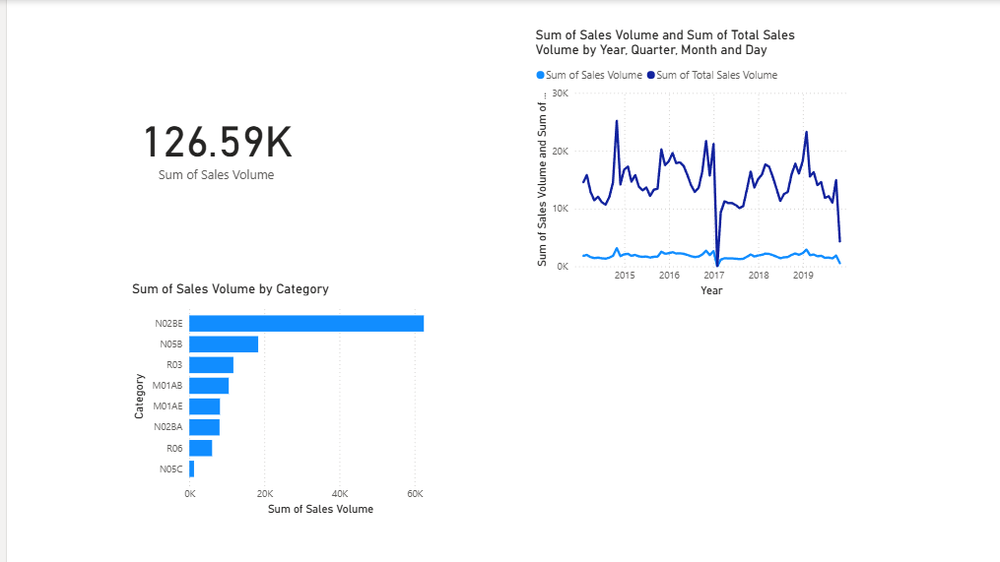

# Pharmaceutical Sales Analysis and Demand Forecasting

## Problem
A pharma company wants to know which medicine categories sell the most, how sales change over time, and what demand to expect next month, so it can plan stock.

## Data
- File: `salesmonthly.csv` (monthly sales volume, 2015 to 2019)
- 8 medicine categories (ATC drug classes): N02BE, N05B, R03, M01AB, M01AE, N02BA, R06, N05C

## Tools Used
Excel, R (ggplot2), Python (Google Colab), Power BI

## Steps
1. **Excel:** Cleaned and filtered the data, grouped sales by category and month, and made a line chart.
2. **R:** Calculated total sales by category and by month, plotted both with ggplot2, and built a 3-month moving-average forecast (tested on the last 6 months, error measured with MAE).
3. **Python:** Repeated the analysis to cross-check the results (`Pharma_sales_validation.ipynb`).
4. **Power BI:** Built a dashboard with a total sales KPI, sales by category, and a monthly trend line.

## Key Findings
- Total sales volume is 126.59K.
- N02BE (paracetamol-type painkillers) is the top category, at about 47% of total sales.
- Sales show ups and downs over time, with a visible dip around 2017.

## Files
- `Pharma_Sales_Analysis.xlsx`: Excel analysis
- `Plot R.R`: R script
- `Pharma_sales_validation.ipynb`: Python notebook
- `Pharma Sales Analysis BI.pbix`: Power BI dashboard
- `Dashboard.png`: dashboard screenshot

## Dashboard

